<div align="center">

# Paweł Pozorski

Data science, NLP and explainability · Warsaw

[](https://www.linkedin.com/in/pawel-pozorski)
[](https://orcid.org/0009-0007-0728-1043)
[](mailto:pozorski.paul@gmail.com)
[](https://pypi.org/user/Pawlo77/)

</div>

---

I'm doing an MSc in Data Science at [Warsaw University of Technology](https://www.mini.pw.edu.pl), where I also finished my BSc with honors. I write Python and SQL for a living, and in my free time I try to work out why large models say what they say.

My bachelor's thesis turned into a paper on explaining text-audio language models with Shapley values. Along the way I got into the less glamorous part of research: packaging code so other people can install it, rerun it and get the same numbers. I'm also co-founder of [Botuj](https://botuj.pl), an AI chat and voice assistant for customer support.

## Research

My work so far is about explaining multimodal language models. Newest first.

### 2026

**[mllm-shap: A Shapley Value Explainability Platform for Text-Audio Multimodal Large Language Models](https://aclanthology.org/2026.acl-demo.38/)**
Jakub Muszyński, Paweł Pozorski, Maria Ganzha
*ACL 2026, System Demonstrations*, pp. 387–396

An open-source platform that extends Shapley-value attribution from text-only LLMs to models that take both text and audio. It masks each modality separately, tracks multi-turn conversations, and groups audio tokens by phonetic alignment, which shrinks the number of coalitions to evaluate by 10–50×.

[Paper](https://aclanthology.org/2026.acl-demo.38/) · [PDF](https://aclanthology.org/2026.acl-demo.38.pdf) · [Code](https://github.com/Pawlo77/MLLM-SHAP) · [Docs](https://pawlo77.github.io/MLLM-SHAP/) · [PyPI](https://pypi.org/project/mllm-shap/)

<details>
<summary>BibTeX</summary>

```bibtex
@inproceedings{muszynski-etal-2026-mllm,
    title = "mllm-shap: A Shapley Value Explainability Platform for Text-Audio Multimodal Large Language Models",
    author = "Muszy{\'n}ski, Jakub and Pozorski, Pawe{\l} and Ganzha, Maria",
    editor = "Durrett, Greg and Jian, Ping",
    booktitle = "Proceedings of the 64th Annual Meeting of the Association for Computational Linguistics (Volume 3: System Demonstrations)",
    month = jul,
    year = "2026",
    address = "San Diego, California",
    publisher = "Association for Computational Linguistics",
    pages = "387--396",
    doi = "10.18653/v1/2026.acl-demo.38"
}
```

</details>

Full list on [ORCID](https://orcid.org/0009-0007-0728-1043).

## What I'm working on

- **[MLLM-SHAP](https://github.com/Pawlo77/MLLM-SHAP)** is the library behind the paper. It's now growing into a general tool for conversational models: Shapley and Banzhaf attributions, reproducible run archives, and backends for Hugging Face, LM Studio and OpenAI-compatible APIs.
- **[mllm-xai](https://github.com/Pawlo77/mllm-xai)** is the research workspace around it, with experiments and write-ups driven by YAML configs.
- **[happy-housing](https://github.com/Pawlo77/happy-housing)** is a side project for the Warsaw housing market. It estimates fair prices and shows explainable maps built only from open data.

## Other projects

- **[AutoPrep](https://github.com/Pawlo77/AutoPrep)** ([PyPI](https://pypi.org/project/auto-prep/)): automated preprocessing for ML, with explainability and reports.
- **[lm-studio-dash](https://github.com/Pawlo77/lm-studio-dash)**: a dashboard for model usage and hardware load when running LM Studio on a Mac.
- **[python-package-template](https://github.com/Pawlo77/python-package-template)** and **[python-project-template](https://github.com/Pawlo77/python-project-template)**: the uv-based scaffolds I start new packages and experiments from.
- University work: speech recognition with transformers, anomaly detection, clustering, CINIC-10 classification and a few more, all in my repositories.

## Stack

<div align="center">
  

  <br />

  
  
  
  
</div>

Also SQL, Snowflake (SnowPro Core certified), Hugging Face Transformers and Streamlit.

## Activity

<div align="center">





</div>

---

<div align="center">

Happy to talk about explainability, speech and language models, or reproducible ML.
[LinkedIn](https://www.linkedin.com/in/pawel-pozorski) · [Email](mailto:pozorski.paul@gmail.com)

</div>
